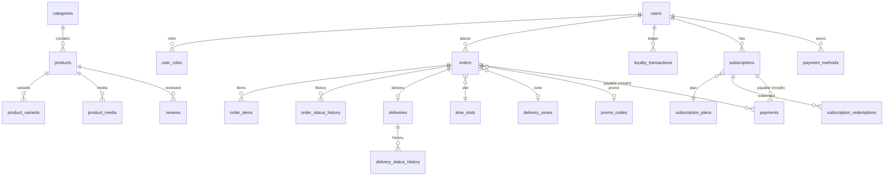

# Схема БД (MySQL 8, utf8mb4)

Суммы — целые **копейки**. Баллы лояльности — целые рубли. Время — UTC, бизнес-логика слотов — `Europe/Moscow`.

| Таблица | Назначение | Ключевые поля и индексы |
|---|---|---|
| `users` | покупатели и сотрудники | `email` unique, `phone`, `pd_consent_at`, `marketing_consent`, `two_factor_secret` (encrypted), `is_active`, `anonymized_at` |
| `user_roles` | роли (можно несколько) | PK (`user_id`, `role`): customer, seller, courier, admin |
| `personal_access_tokens` | токены Sanctum | `abilities` (customer / staff + role:*), `expires_at` |
| `categories` | категории | `slug` unique, `cross_listed` (json: slug товаров из других категорий), `items` (json), SEO-поля |
| `products` | товары | `slug` unique, `category_id`, `is_pp`, `related` (json), SEO-поля, FULLTEXT(`name`, `description`) |
| `product_variants` | варианты (SKU) | `sku` unique, `price`, `price_from`, `stock`, `reserved` |
| `product_media` | фото и видео | `type`, `name` (базовое имя файла в `/media`), `alt` |
| `seo_pages` | SEO-переопределения контентных страниц | `path` unique |
| `promo_codes` / `promo_redemptions` | промокоды и использования | `type` percent/fixed, лимиты, `category_ids`, срок |
| `time_slots` | слоты самовывоза и интервалы курьера | unique(`type`, `date`, `starts_at`), `capacity`, `booked` |
| `delivery_zones` | зоны курьерской доставки | `polygon` json [[lat, lng]…], `price`, `min_order`, `free_from`, `eta_minutes` |
| `orders` | заказы | `number` unique, `status` (автомат OrderStatus), `fulfilment`, контакты, `address` json, суммы, `reserved_until`, `tracking_token` unique |
| `order_items` | позиции | снимок названия, SKU и цены на момент заказа |
| `order_status_history` | история статусов | `from`, `to`, `user_id` (автор), `comment`, время |
| `cart_items` | серверная корзина | PK (`user_id`, `product_variant_id`) |
| `favorites`, `reviews` | избранное, отзывы | отзыв unique(`order_id`, `product_id`), `status` pending/approved/rejected |
| `payments` | платежи | morph `payable` (order / subscription), `provider_payment_id` unique, `idempotency_key` unique, `purpose` initial/renewal |
| `webhook_events` | журнал вебхуков | unique(`provider`, `event_id`) — идемпотентность |
| `payment_methods` | сохранённые карты | `token` (encrypted) |
| `loyalty_transactions` | **неизменяемый** журнал баллов | `type` earn/spend/refund/expire/adjust, `amount` со знаком, `idempotency_key` unique, `expires_at` |
| `subscription_plans`, `subscriptions`, `subscription_redemptions` | абонементы | статус (автомат SubscriptionStatus), периоды, `retry_count`, `grace_until`; погашения по дням |
| `deliveries` | курьерские доставки | `order_id` unique, `courier_id`, `status` (автомат DeliveryStatus), `route_position`, COD, фото |
| `delivery_status_history` | история доставки | автор, геометка `lat`/`lng`, `happened_at` (время на устройстве), `client_action_id` unique (офлайн-повторы) |
| `courier_shifts` | смены курьеров | начало/конец, касса (наличные/карта) |
| `jobs`, `failed_jobs`, `cache` | очереди и кеш | драйвер `database` |

## Конечные автоматы

- **Заказ**: `pending_payment → paid → accepted → preparing → ready → (completed | handed_to_courier → completed | shipped → completed)`; отмена из любого незавершённого.
- **Доставка**: `assigned → accepted → picked_up → in_transit → (delivered | failed → (returned | in_transit))`.
- **Абонемент**: `pending → active ⟲ → (past_due ⟲ → grace | grace) → expired`; `cancelled → expired`.

Переходы описаны в `app/Enums/*` (`next()`), проверяются под блокировкой строки и пишутся в историю.
